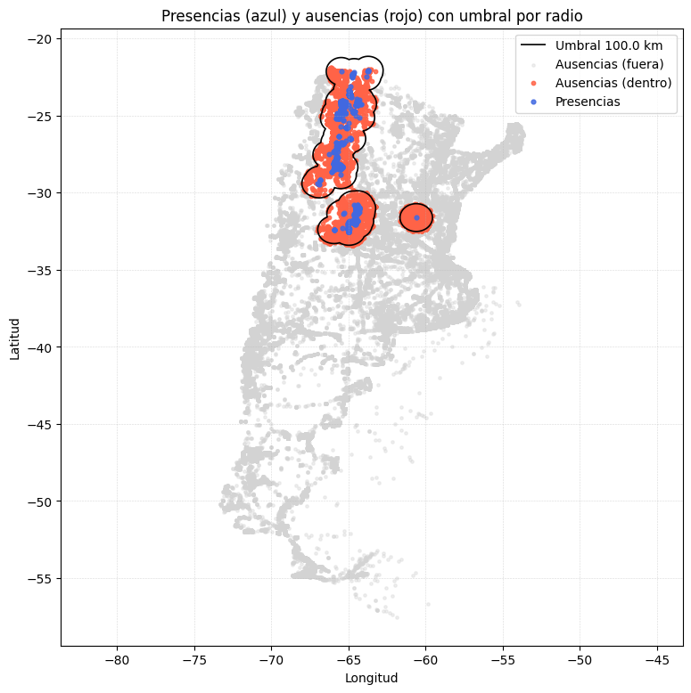
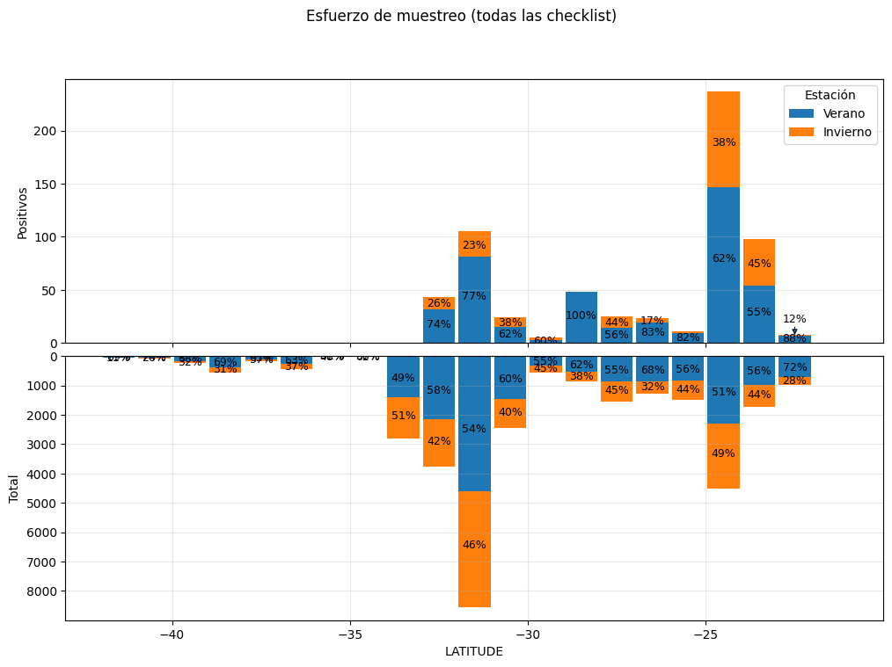
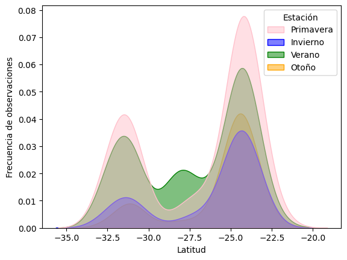

# GeoBio – eBird checklist utilities for species-distribution exploration

A small Python library that turns raw **eBird** sightings + sampling-event files into analysis-ready presence/absence data and
produces spatial and seasonal diagnostics. It was also used in an (unfinished) species-distribution study of the endangered *Podiceps gallardoi*
(Hooded grebe) in Patagonia. The bundled demo runs on an eBird dataset for a migratory bird of north-western Argentina, analysed by latitude segment and season.



## Features
- **Presence/absence from checklists** (`build_presence_from_checklists`) and quality filtering (`filter_data`: distance, observers, duration, protocol).
- **Spatial filters**: keep absences within a radius of presences, or inside/outside an ecoregion polygon (`plot_checklists_radio_static`, `filtrar_checklists_por_region_fast`).
- **Interactive maps** with Folium and polygon-based segmentation of sightings.
- **Raster extraction** of environmental variables at sighting locations (`extraer_variables_especificas`).
- **Seasonal analysis**: latitude/temperature/precipitation/altitude densities and box-plots by segment and season, monthly frequencies,
  and a mirrored presence-vs-effort plot by latitude band.

| Sampling effort vs. presences by latitude | Latitude by season |
|---|---|
|  |  |

## Install
```bash
pip install -e .
```
```python
import geobio as gb
merged = gb.build_presence_from_checklists(sightings_path="ebd.txt", checklist_path="ebd_sampling.txt")
clean  = gb.filter_data(merged, max_distance_km=5, max_observers=10, max_duration_min=300)
```
See `notebooks/demo_geobio.ipynb` for the full walk-through.

## Status
Research utilities consolidated from a working notebook (`geobio/core.py`). Function names mix English and Spanish, there are no unit tests yet,
and the demo needs data that cannot be redistributed (see `data/README.md`). The *P. gallardoi* climatic-niche modelling is **unfinished**; this repo only covers the data-preparation and exploratory layer.

> **Note:** originally developed and run in Google Colab. Google-Drive mounting cells were removed, Drive paths were rewritten as relative paths and outputs were stripped (figures of the original run are in `assets/`). The paths/cleanup were **not re-executed** after this change, so expect to adjust paths.

## Author
Tiago Alejo Herrador
