<p align="center"></p>

# BioDyn – looking at where and when a species is recorded, before modelling it

**BioDyn** is an R package for exploring *occurrence records* of a species (for example bird sightings from eBird) across **space, seasons and environment**. It is meant for the step *before* any model: checking what the data actually contain, how unevenly people sampled, and whether different parts of a population behave differently over the year.

It is described in the article *"BioDyn: A tool for the spatiotemporal analysis of intra-specific geographic data"* (Herrador, Reati, Huais, Osorio-Olvera, Contreras-Díaz, Peluc & Nori, *Biodiversity Informatics* 20, 2026, 275–285), and the package files are archived on Zenodo ([doi:10.5281/zenodo.19055001](https://doi.org/10.5281/zenodo.19055001)).

## Why it exists, and what it is for

Citizen-science platforms hold millions of records, but they are uneven: some places and months are visited far more than others. A map of points can then show *where observers were* instead of *where the species is*. This gets worse when you care about **movements**, such as a migratory species whose northern and southern populations are in different places in different seasons.

BioDyn puts the usual steps for this in one place, so they are reproducible and easy to repeat on another species:

- build a **presence/absence table** from eBird, so that an *absence* means "someone looked and did not see it", not "nobody went there";
- **filter the records by sampling effort** (distance, duration, number of observers, protocol);
- **cut the area** with an ecoregion, a radius around the presences, or **segments you draw yourself** on a map;
- add the **season** (aware of the hemisphere) and **environmental values** (climate, elevation) at each record;
- draw the **diagnostic plots**: sampling effort along latitude, records per month, climate and elevation by season.

It is a *diagnostic* tool. It does not fit models and it does not prove anything about migration: it helps you see the pattern, and see whether sampling effort could be fooling you.

## The workflow

| Step | Functions | What it does |
|---|---|---|
| 1. Presence/absence | `build_data()` | Crosses eBird sightings with the checklist file: a checklist with the species is `Present`, the rest are `Absent` |
| 2. Effort filter | `filter_ebird()` | Keeps checklists within a maximum distance, number of observers and duration, for chosen protocols, complete checklists only, no duplicates |
| 3. Spatial filter and segments | `filter_ecoregion()`, `filter_radius()`, `create_segments()`, `filter_pol()` | Keep points inside an ecoregion (with optional buffer); keep absences within X km of a presence; draw polygons on an interactive map and assign each record to a segment |
| 4. Seasons | `split_dates()`, `add_season()`, `filter_season()` | Day / month / year, and a season that depends on the hemisphere of each record |
| 5. Environment | `extract_rasters()`, `elev_minmax()` | Raster values (e.g. CHELSA climate, a DEM) at each point; minimum and maximum elevation available inside each segment |
| 6. Plots | `plot_effort()`, `plot_variable()`, `plot_altitude()`, `create_ggplot_visualizations()`, `create_segment_interactive_maps()` | The diagnostic plots |

The steps do not have to be run in order, and every function takes and returns a plain table, so you can stop, branch or repeat anywhere. If you only have presence records (no checklists), everything works except `build_data()` and `plot_effort()`, which need the absences.

## An example: a migratory bird in Argentina

The article uses the chocolate-vented tyrant (*Neoxolmis rufiventris*), which breeds in Patagonia in the austral summer and winters in the Pampas. I re-ran the whole workflow on that example with this version of the package. **Every figure below is the direct output of a BioDyn function** (the script is [`inst/scripts/step2_figures.R`](inst/scripts/step2_figures.R)).

**The numbers of the article are reproduced.** From the eBird files (3,329 presence records and 1,010,756 checklists for Argentina), the effort filter (≤ 10 km, ≤ 10 observers, ≤ 300 min, stationary or travelling) keeps **814 records and 280,958 checklists**, the same as in the article.

**`filter_ecoregion()`** (left) keeps the records inside the chosen ecoregions, here the Patagonian steppe and the Humid Pampas: teal dots are kept, faint grey dots were left out. **`filter_radius()`** (right) keeps only the checklists within 20 km of a presence, so that "absences" come from places where the species could have been seen: grey dots are the checklists that were dropped and the black outline is the union of the 20 km buffers.

<table>
<tr>
<td>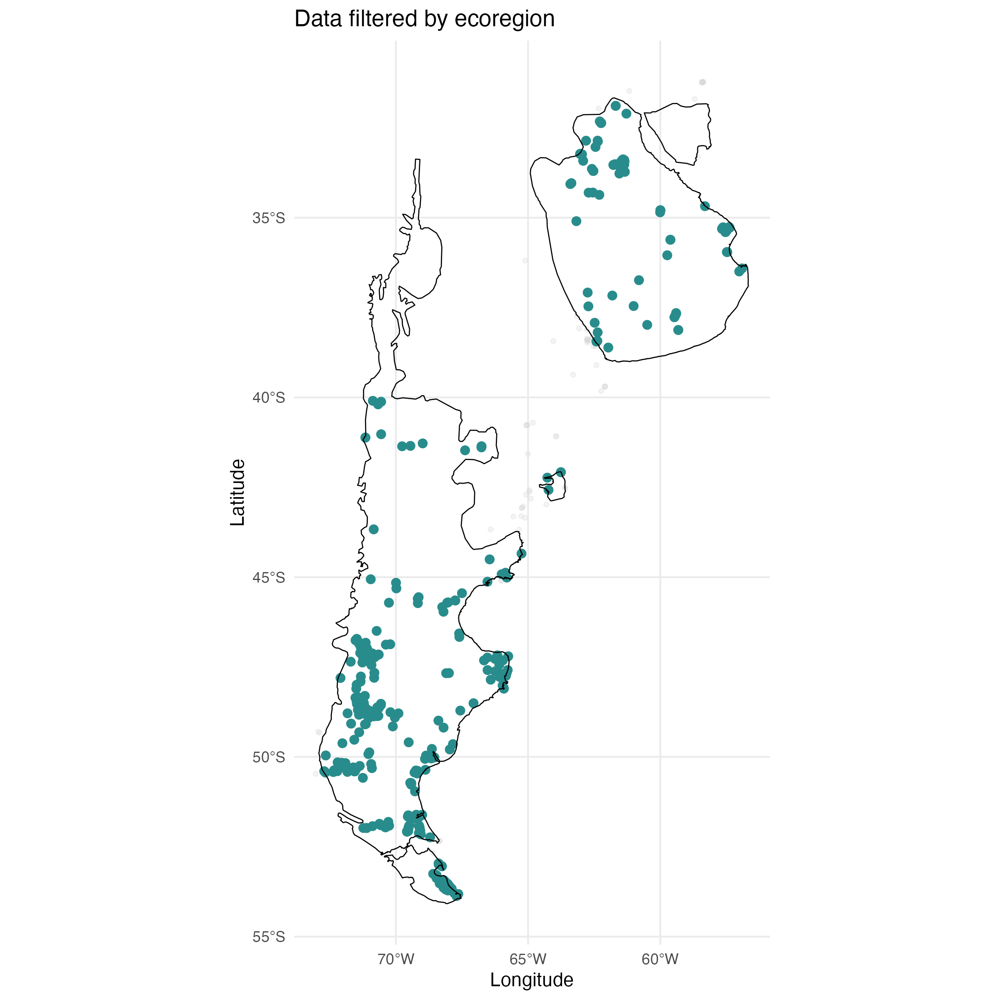</td>
<td>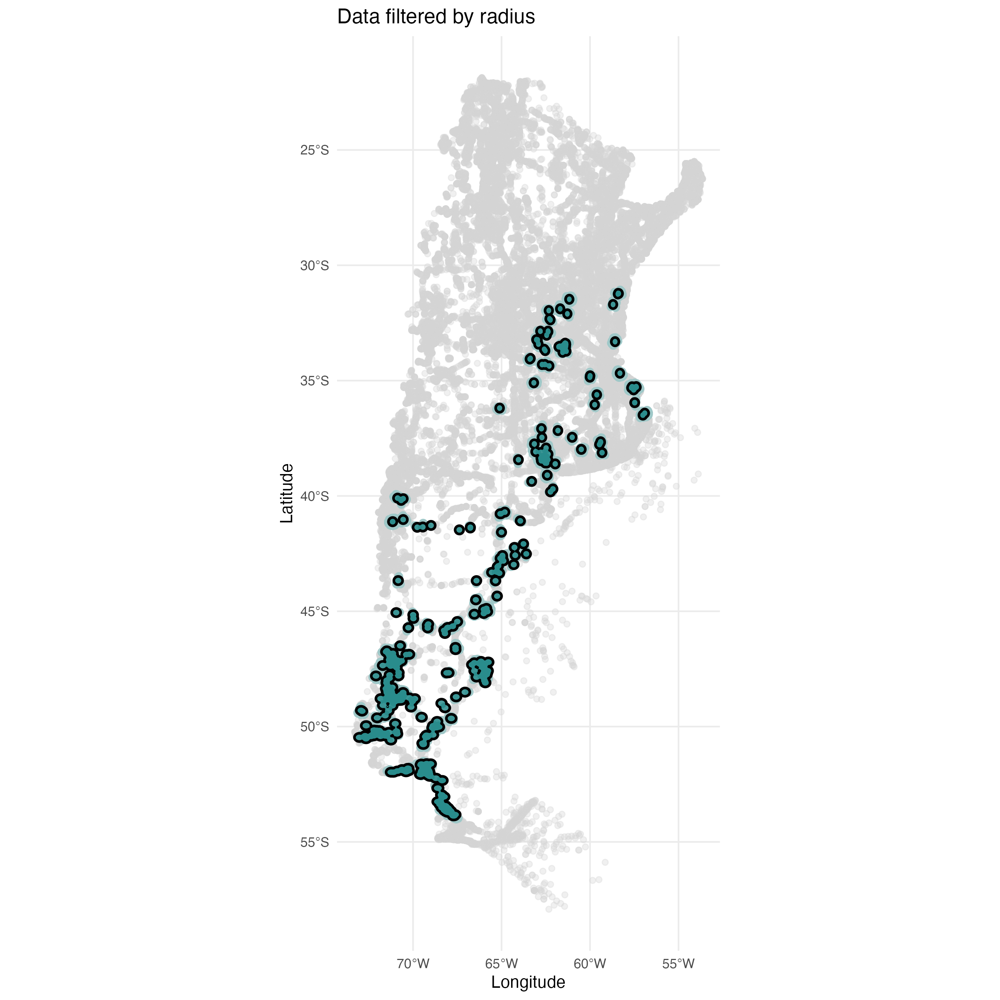</td>
</tr>
</table>

**Drawing the segments.** `create_segments()` opens an interactive map with the records, and you draw the polygons you want with the toolbar (left); the save button (top right) exports them as a GeoJSON file. `filter_pol()` then reads that file and gives another interactive map where every segment has its own colour. Left: the three rectangles drawn in `create_segments()`. Right: the result in `filter_pol()`.

<table>
<tr>
<td>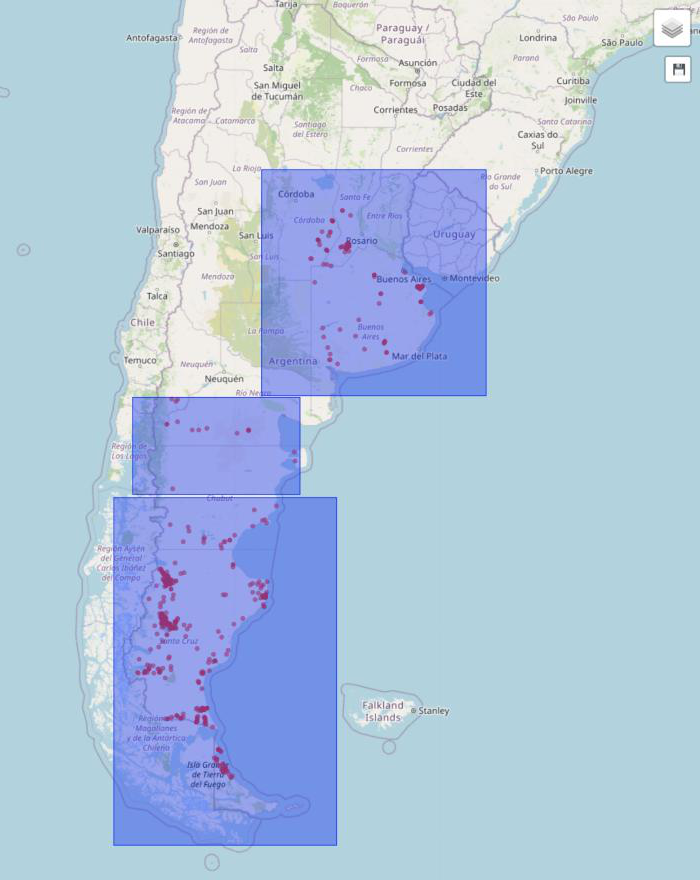</td>
<td>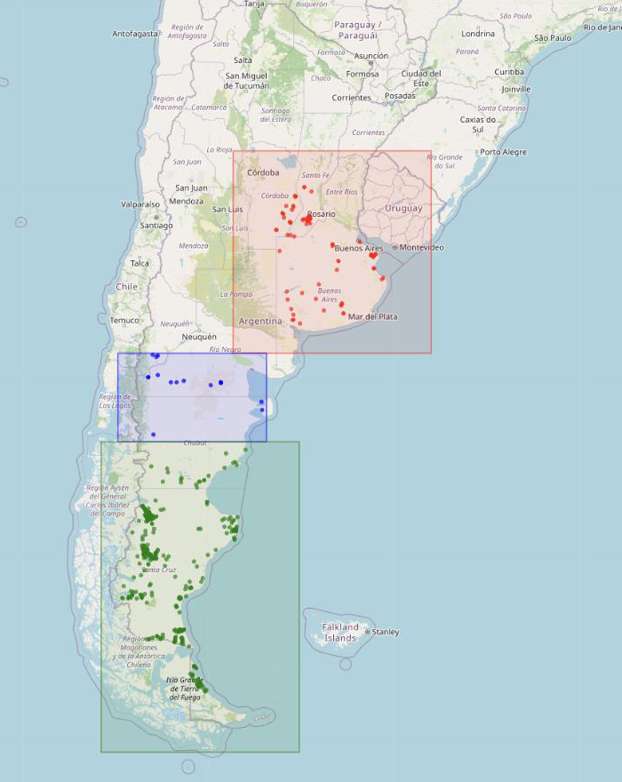</td>
</tr>
</table>

**`filter_pol()`** assigns each record to the segment that contains it (the segments are the polygons you draw with `create_segments()`; here, three rectangles I drew for the example) and draws a summary of how many records fell in each:

<table>
<tr>
<td>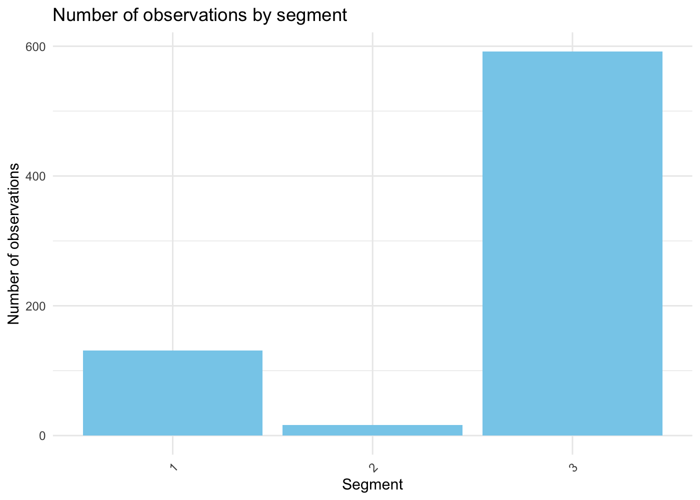</td>
<td>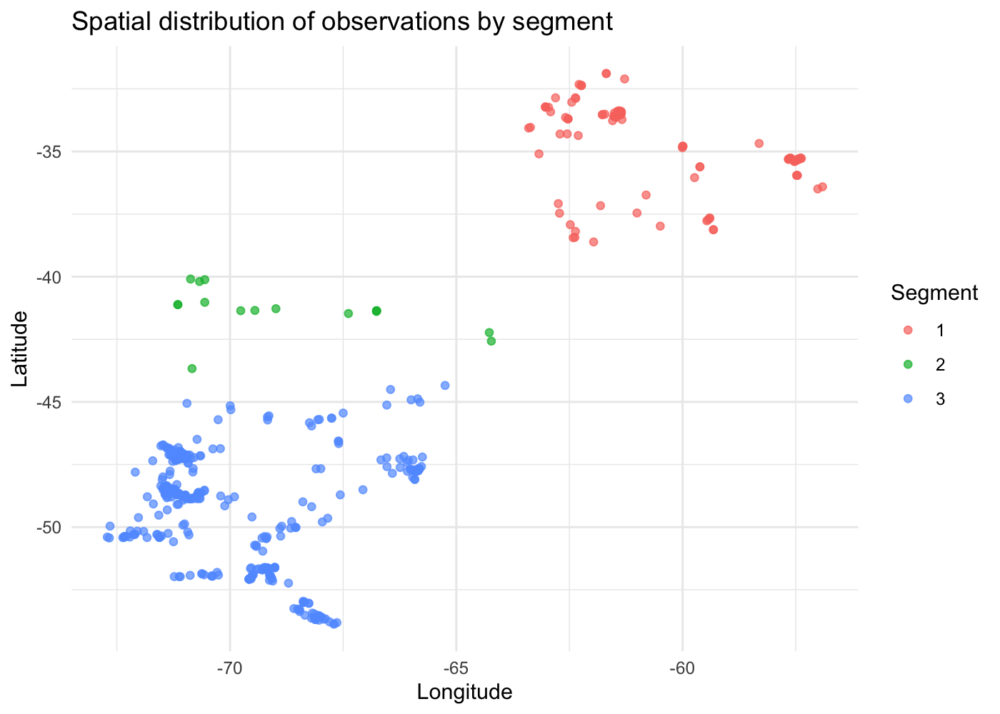</td>
</tr>
</table>

**`plot_effort()`** shows, for each degree of latitude, what share of the checklists (left) and of the presences (right) fell in each season:

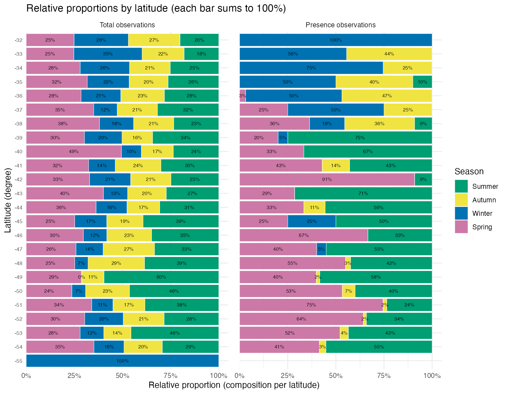

On the left every season is represented at almost every latitude, so effort is fairly even through the year. On the right, the northern degrees are mostly autumn and winter and the southern ones spring and summer. Since sampling did not itself shift with the seasons, that change is more likely to be the bird than the observers. This is exactly the check `plot_effort()` is for.

**`plot_variable()`** draws any variable of the table by season, here the annual mean temperature (CHELSA `bio01`) at the records, extracted with `extract_rasters()`:

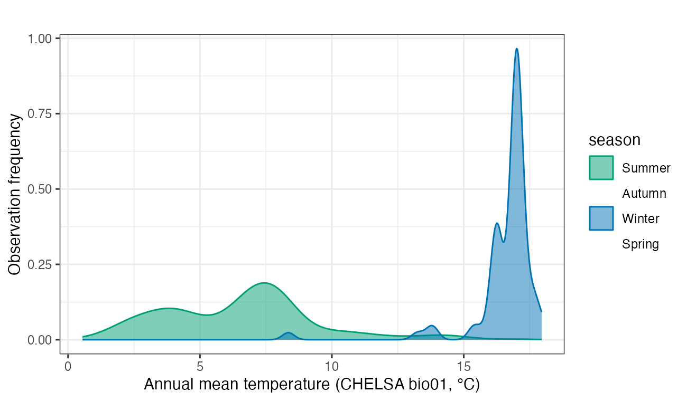

Summer and winter records hardly overlap in temperature, which agrees with the article, but, as the article warns, this mostly reflects that the bird is at different latitudes in each season, not that it picks different climates.

`plot_variable()` works with any numeric column of the table (`var = "bio01"`, `"LATITUDE"`, `"Altitude"`...), colours the records by season, and has a few options: `type` (`"density"`, `"histogram"`, `"boxplot"` or `"line"`), `seasons` (which seasons to show) and `segment = TRUE`, which draws one plot per segment. The same temperature as a histogram, and the latitude of the records as a histogram:

<table>
<tr>
<td>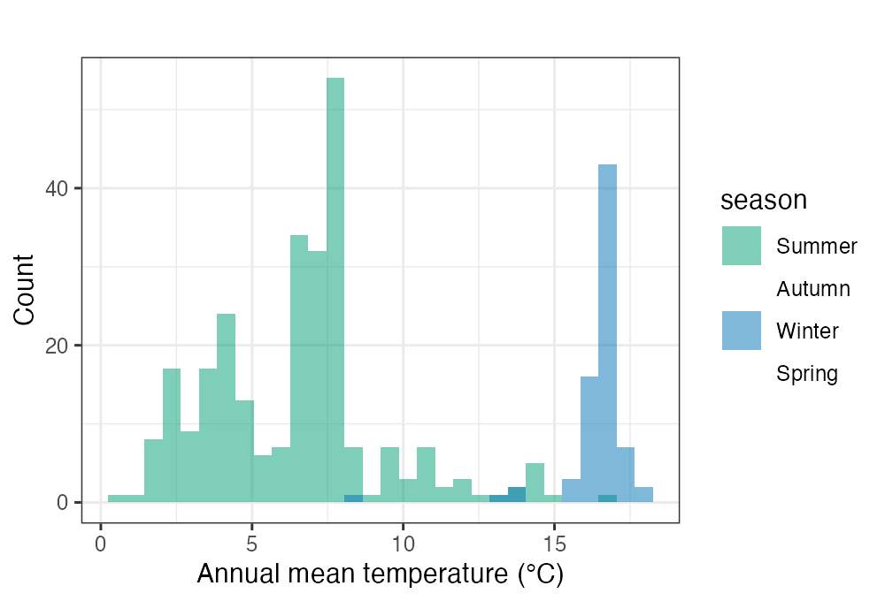</td>
<td>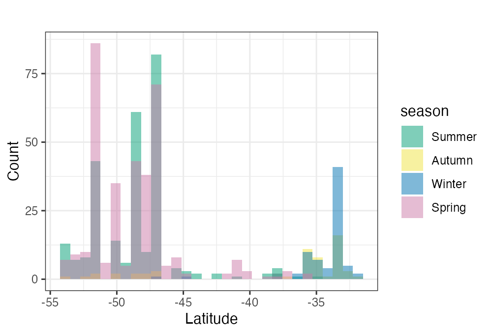</td>
</tr>
</table>

And the temperature one plot per segment (`segment = TRUE`), which shows that in the northern segment (left) the summer and winter records come from clearly different temperatures:

<table>
<tr>
<td>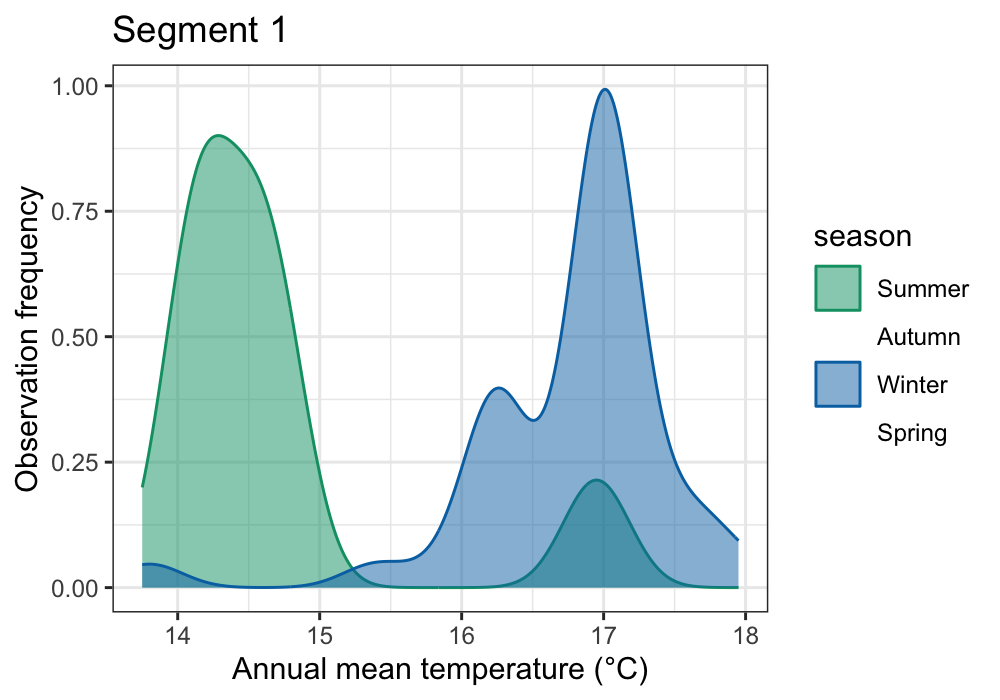</td>
<td>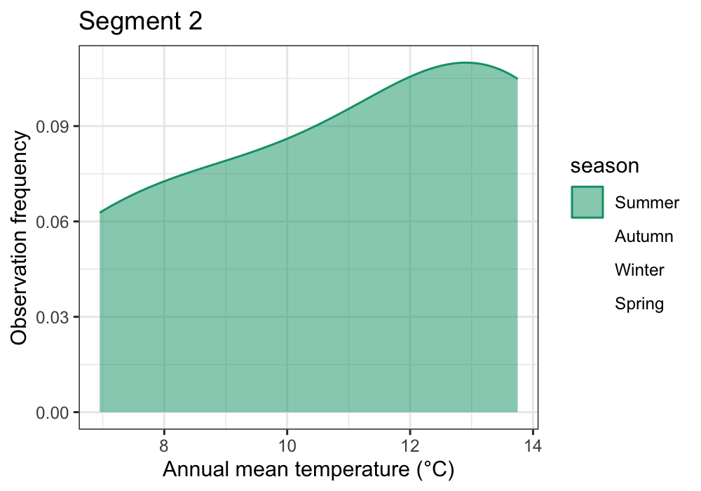</td>
<td>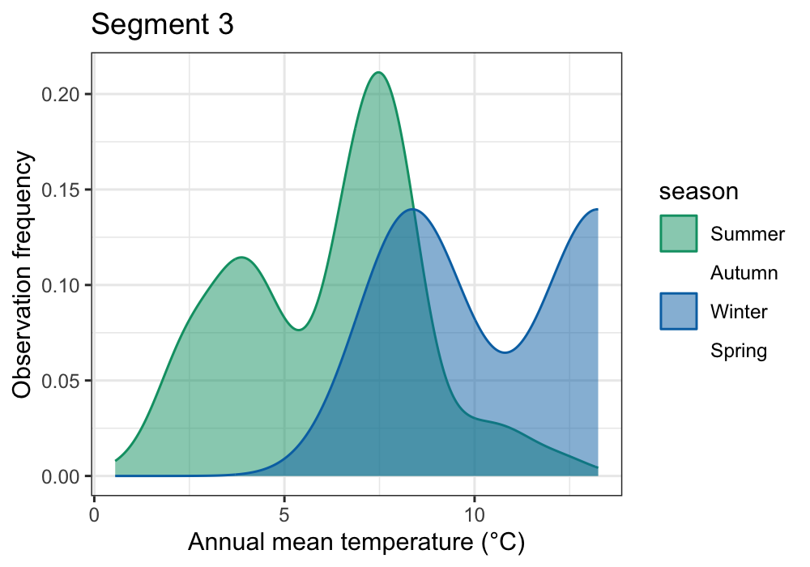</td>
</tr>
</table>

## Install

BioDyn is distributed from Zenodo ([doi:10.5281/zenodo.19055001](https://doi.org/10.5281/zenodo.19055001)). Download the source package `BioDyn_0.1.0.tar.gz` from there and install it from R:

```r
install.packages("path/to/BioDyn_0.1.0.tar.gz", repos = NULL, type = "source")
```

The same Zenodo record has the example dataset of the article (`Example_nrufiventris.rar`).

R ≥ 4.1. It uses `sf`, `terra`, `ggplot2`, `dplyr` and `leaflet`. `elev_minmax()` also needs `raster` and `exactextractr`, and the interactive maps need `plotly` and `htmlwidgets`.

## Use

```r
library(BioDyn)

presence <- build_data(sightings_file = "occurrences.txt",
                       checklist_file = "checklists.txt", sep = "\t")

checklists <- filter_ebird(presence, max_distance_km = 10, max_observers = 10,
                           max_duration_min = 300,
                           protocols = c("Stationary", "Traveling"))

near <- filter_radius(checklists, radius_km = 20, interactive = FALSE)

seasonal <- add_season(split_dates(near))
plot_effort(seasonal)
```

The full walk-through, from raw eBird files to every plot, is the vignette: `vignette("flow_example", package = "BioDyn")`. The scripts in [`inst/scripts`](inst/scripts) are the ones I used for the numbers and figures above.

## Data

The eBird files are **not in this repository**. eBird's terms of use do not allow its data to be redistributed in their original form: request the *Basic Dataset* and the *sampling* file for your species and region at <https://ebird.org/data/download>. The example files of the article are on [Zenodo](https://doi.org/10.5281/zenodo.19055001). Climate layers (CHELSA) and elevation models come from their own providers.

The tests use tiny hand-made tables and need no real data.

## Things to keep in mind

- **It only works with occurrence data.** There is no abundance, movement or genetic information, so conclusions about populations or migratory connections are indirect.
- **Drawing segments is a judgement call.** That is the point (you bring your knowledge of the species), but two people can draw different segments.
- **`build_data()` treats every row of the sightings file as a detection of your species.** Give it a sightings file for one species only.
- **The effort filter is as good as its thresholds.** The defaults follow Johnston et al. (2021) but suit some questions better than others.
- **`filter_ebird()` removes duplicates by date and latitude.** That is quick, but two different checklists on the same day at the same latitude count as duplicates.
- **`plot_effort()` only looks at latitude.**
- **With recent versions of `ggplot2`, `plot_variable()` fails for `type = "line"` and for `type = "boxplot"` with seasons**; `"density"` and `"histogram"` work.
- This is version 0.1.0 of a young package.

## What this repository adds to the archived version

The package code (`R/`, `man/`, `NAMESPACE`) is exactly the one archived on Zenodo. What this repository adds around it: tests (with tiny hand-made tables, no real data), continuous integration, the example scripts in `inst/scripts`, this README, the authors' details and the MIT licence in `DESCRIPTION`.

## Authors and licence

Tiago A. Herrador and Carla A. Reati wrote the package; the article lists all authors. MIT licensed. If you use BioDyn, please cite the article above and the eBird data you used.
