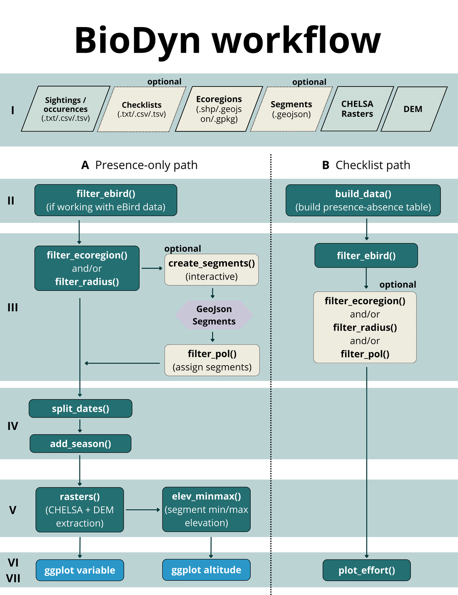
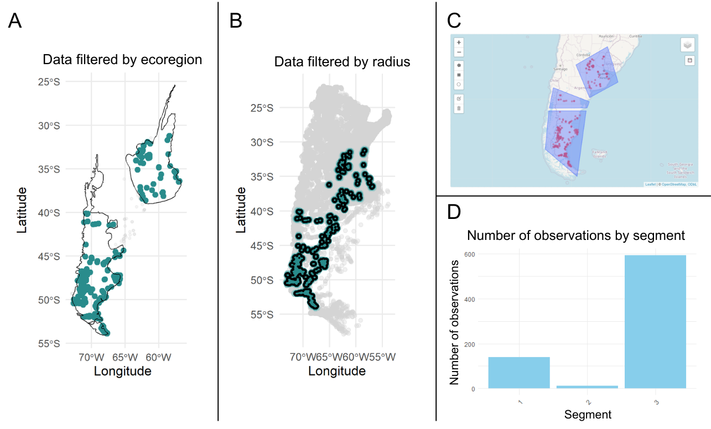
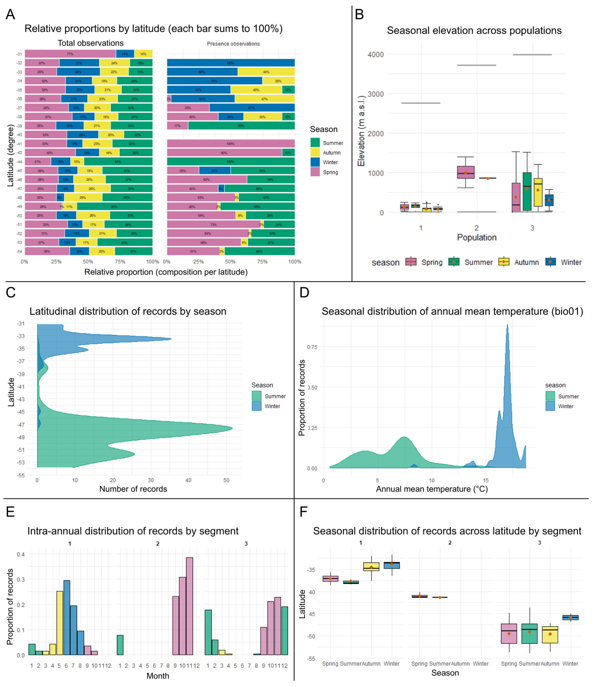

<p align="center"></p>

# BioDyn – looking at where and when a species is recorded, before modelling it

**BioDyn** is an R package for exploring *occurrence records* of a species (for example bird sightings from eBird) across **space, seasons and environment**. It is meant for the step *before* any model: checking what the data actually contain, how unevenly people sampled, and whether different parts of a population behave differently over the year.

It is described in the article *"BioDyn: A tool for the spatiotemporal analysis of intra-specific geographic data"* (Herrador, Reati, Huais, Osorio-Olvera, Contreras-Díaz, Peluc & Nori, *Biodiversity Informatics* 20, 2026, 275–285), and the package files are archived on Zenodo ([doi:10.5281/zenodo.19055001](https://doi.org/10.5281/zenodo.19055001)).

## Why it exists, and what it is for

Large biodiversity databases (eBird, GBIF, iNaturalist, VertNet) now hold billions of records, but more data does not automatically mean more knowledge. The records carry biases and gaps, and sampling effort, temporal resolution and environmental coverage are very uneven. That leaves holes in what we know about where species actually occur, especially when a distribution is treated as something that changes over time and not as a fixed map.

Time has received less attention than space, particularly *within* a single species, where seasonal changes, differences between populations and migration matter a lot. Studying them takes several stages (cleaning the data, cutting it into spatial segments, linking each record to the environment, plotting), and these are usually spread over different tools.

BioDyn brings those stages into one reproducible and flexible workflow to **explore occurrence records in space, seasons and environment before any formal modelling**, with a focus on seasonal and between-year variation within a species. With it you can:

- build a **presence/absence table** from eBird, so a real absence is told apart from a place that was never sampled;
- **filter the records by sampling effort**, following the guidelines of Johnston et al. (2021);
- **cut the area** with an ecoregion, a radius around the presences, or **segments you draw yourself** on an interactive map;
- add the **season** of each record and **environmental values** (climate, elevation), including the elevation range available in each segment;
- draw **diagnostic plots** of sampling effort, seasonal patterns and environmental distributions, and interactive maps.

It is a *diagnostic* tool. It helps you assess data coverage, spot sampling biases and information gaps, and form hypotheses about seasonal and spatial structure before modelling.

## The workflow

The steps do not have to be run in order, and every function takes and returns a plain table, so you can stop, branch or repeat anywhere. The diagram shows the whole workflow, from the article. It has two paths: if you only have presence records (path A) the data go straight to the spatial filters; if you have checklists (path B) `build_data()` first builds the presence/absence table from the eBird files, which lets the package tell a real absence from a place nobody visited. Dotted boxes are optional steps. Everything works with presences only, except `build_data()` and `plot_effort()`, which need the absences.

<p align="center"></p>

## An example: a migratory bird in Argentina

The article uses the chocolate-vented tyrant (*Neoxolmis rufiventris*), which breeds in Patagonia in the austral summer and winters in the Pampas. All the figures below are from the article (Herrador et al. 2026, *Biodiversity Informatics* 20, 275–285) and were made with BioDyn.

**Cleaning and cutting the data.** From the eBird files (3,329 presence records and 1,010,756 checklists for Argentina), the effort filter (≤ 10 km, ≤ 10 observers, ≤ 300 min, stationary or travelling) keeps **814 records and 280,958 checklists**; I re-ran it with this version of the package and got the same numbers. Then the records are cut by ecoregion and by distance to the presences, and split into three segments (north, centre, south) drawn on an interactive map:

(A) `filter_ecoregion()` keeps the records inside the chosen ecoregions. (B) `filter_radius()` keeps the checklists within 20 km of a presence. (C) The three segments drawn with `create_segments()`. (D) The number of records in each segment, from `filter_pol()`.



**Looking at seasons, elevation and climate.** (A) `plot_effort()`: for each degree of latitude, the share of the checklists (left) and of the presences (right) that fall in each season. (B) Elevation of the records by season in each segment; the grey lines are the lowest and highest elevation available in each segment, from `elev_minmax()`. (C) Latitude of the records in summer and winter. (D) Annual mean temperature (CHELSA `bio01`) of the records in summer and winter. (E) Records per month in each segment. (F) Latitude of the records by season in each segment.



**What it shows.** In panel A (left) every season is represented at most latitudes, so sampling effort is fairly even through the year. In panel A (right) the northern degrees are mostly autumn and winter records and the southern ones spring and summer. Since the checklists did not themselves shift with the seasons, that change is more likely to be the bird than the observers. This is exactly the check `plot_effort()` is for. Summer and winter records also hardly overlap in temperature (D), but, as the article warns, this mostly reflects that the bird is at different latitudes in each season, not that it chooses different climates.

## Install

BioDyn is distributed from Zenodo ([doi:10.5281/zenodo.19055001](https://doi.org/10.5281/zenodo.19055001)). Download the source package `BioDyn_0.1.0.tar.gz` from there and install it from R:

```r
install.packages("path/to/BioDyn_0.1.0.tar.gz", repos = NULL, type = "source")
```

The same Zenodo record has the example dataset of the article (`Example_nrufiventris.rar`).

R ≥ 4.1. It uses `sf`, `terra`, `ggplot2`, `dplyr` and `leaflet`. `elev_minmax()` also needs `raster` and `exactextractr`, and the interactive maps need `plotly` and `htmlwidgets`.

## Use

```r
library(BioDyn)

presence <- build_data(sightings_file = "occurrences.txt",
                       checklist_file = "checklists.txt", sep = "\t")

checklists <- filter_ebird(presence, max_distance_km = 10, max_observers = 10,
                           max_duration_min = 300,
                           protocols = c("Stationary", "Traveling"))

near <- filter_radius(checklists, radius_km = 20, interactive = FALSE)

seasonal <- add_season(split_dates(near))
plot_effort(seasonal)
```

The full walk-through, from raw eBird files to every plot, is the vignette: `vignette("flow_example", package = "BioDyn")`. The script [`inst/scripts/step1_filters.R`](inst/scripts/step1_filters.R) reproduces the record counts of the example above.

## Data

The eBird files are **not in this repository**. eBird's terms of use do not allow its data to be redistributed in their original form: request the *Basic Dataset* and the *sampling* file for your species and region at <https://ebird.org/data/download>. The example files of the article are on [Zenodo](https://doi.org/10.5281/zenodo.19055001). Climate layers (CHELSA) and elevation models come from their own providers.

The tests use tiny hand-made tables and need no real data.

## Things to keep in mind

These are the limitations the article points out:

- **It works only with occurrence data.** It does not include demographic information, movement trajectories, abundance estimates or genetic structure, so conclusions about population differentiation or migratory connectivity are indirect and should be read with caution.
- **Drawing segments involves some subjectivity.** The interactive segmentation is flexible and lets you use your knowledge of the species, but segments defined by expert criteria depend on who draws them.
- **The diagnostics are visual.** BioDyn does not yet give quantitative bias metrics, and it has no interface yet with species-distribution, occupancy or niche modelling frameworks.
- **Presence-only data are supported, with one limit.** Everything works without absences except `build_data()` and `plot_effort()`, which need the inferred absences and the sampling effort.
- **`plot_effort()` looks only at latitude,** because the package focuses on seasonal and migratory dynamics.
- **Climate differences between seasons can be misleading.** If a species is at different latitudes in each season, differences in the climate of its records partly reflect that, and should be interpreted with caution.

## Authors and licence

Tiago A. Herrador and Carla A. Reati wrote the package; the article lists all authors. MIT licensed. If you use BioDyn, please cite the article above and the eBird data you used.
